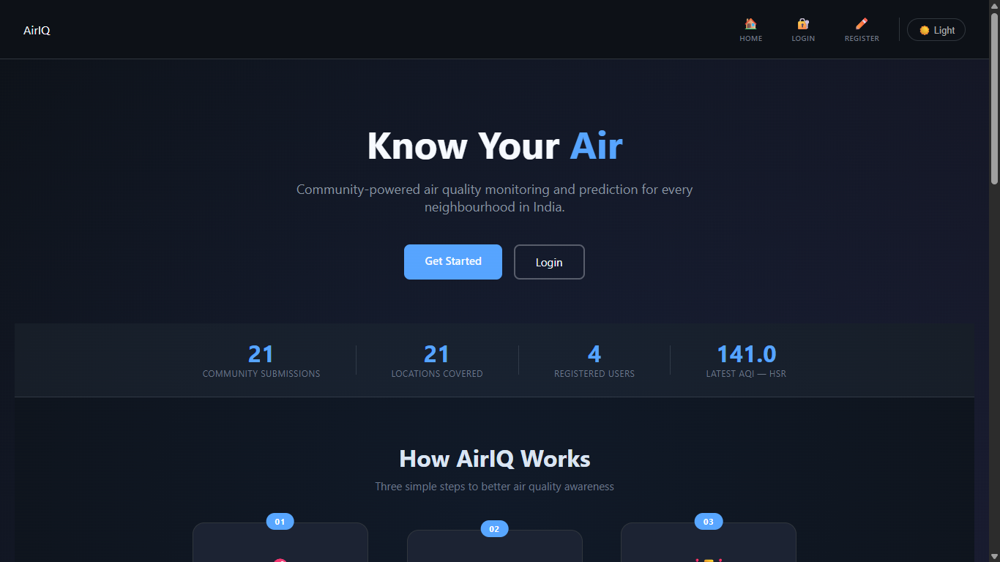
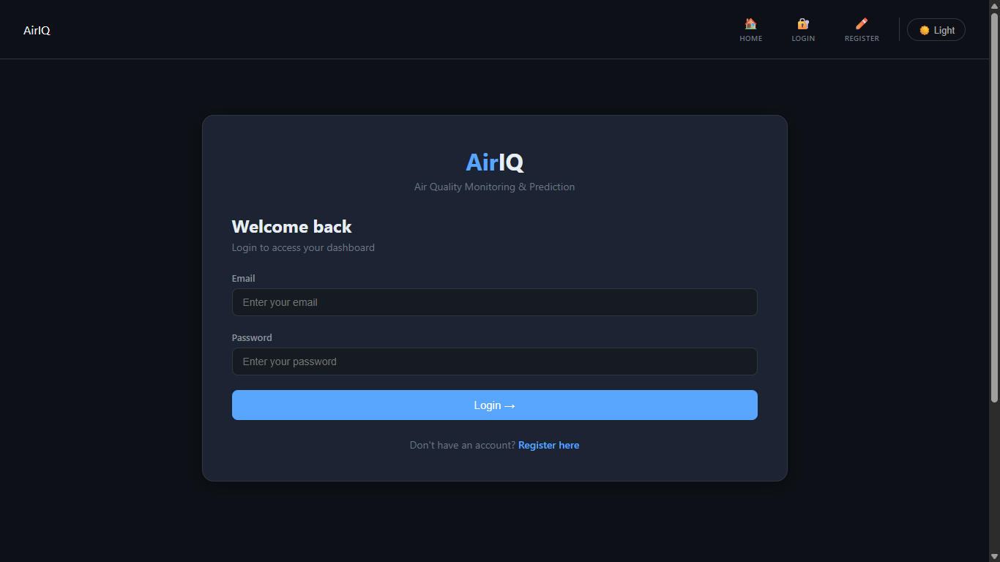
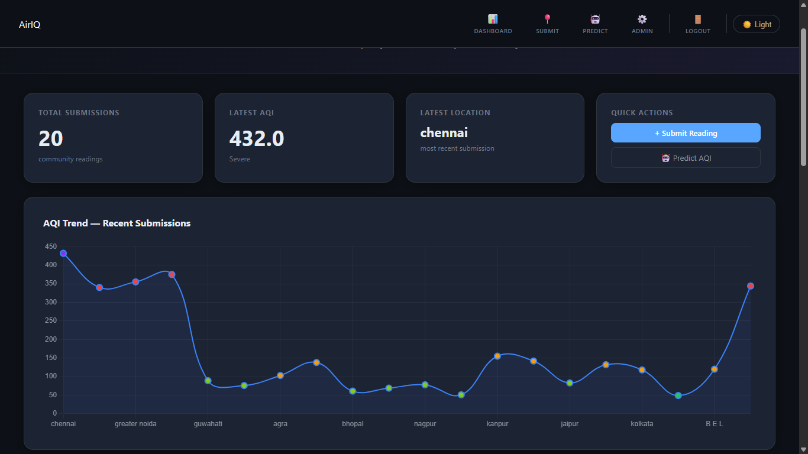
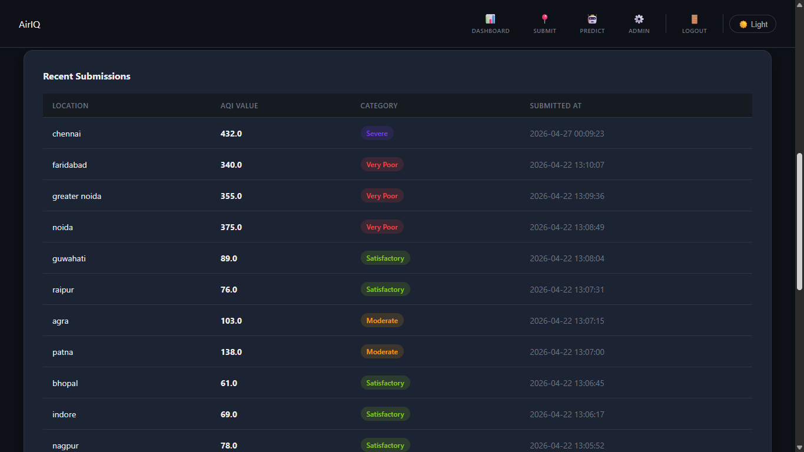
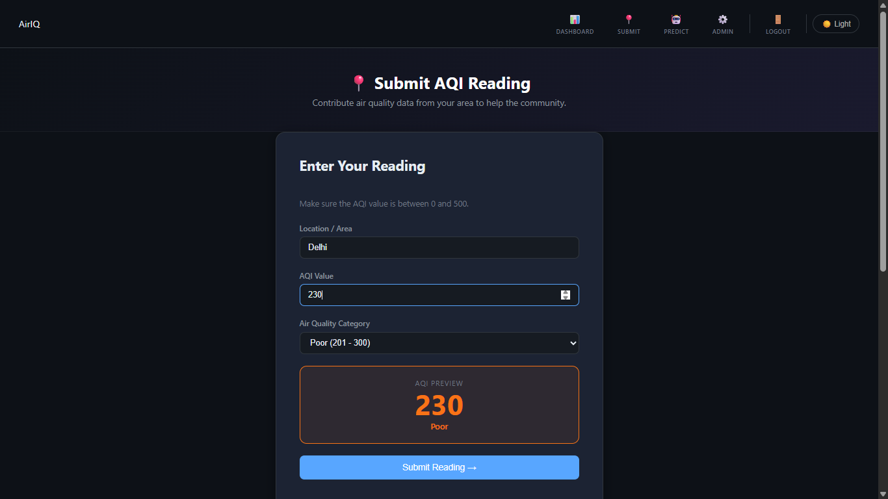
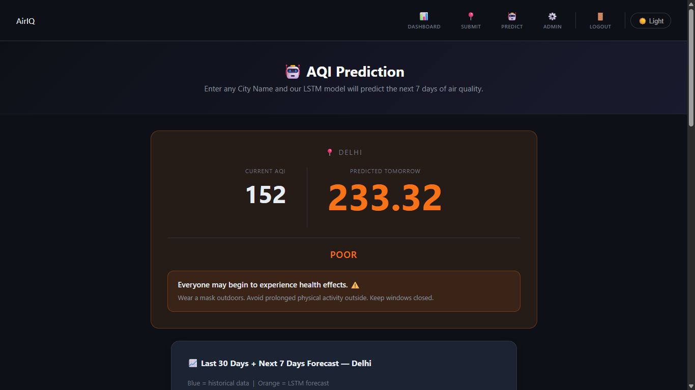
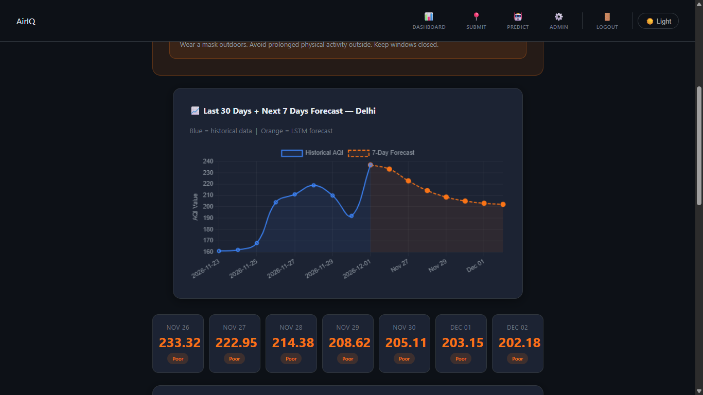
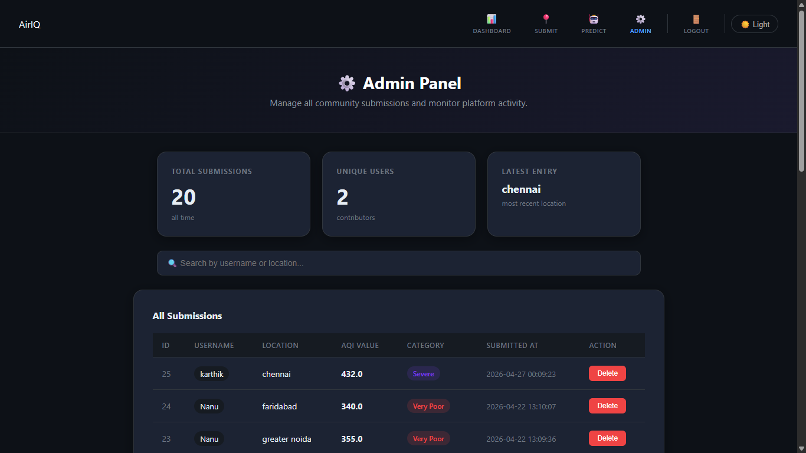

AirIQ – Air Quality Monitoring and Prediction System

AirIQ is a web-based air quality monitoring and prediction system developed using Flask and Python. It allows users to submit air quality readings, monitor AQI trends through an interactive dashboard, and generate seven-day air quality forecasts for Indian cities using a Long Short-Term Memory (LSTM) neural network.

The application combines user-submitted air quality data, external air quality information, and machine learning to provide insights into air pollution levels and their potential health implications.

Table of Contents
Overview
Features
Screenshots
Home Page
User Authentication
Dashboard
AQI Submission
Air Quality Prediction
Seven-Day AQI Forecast
Admin Panel
Technology Stack
Project Structure
Prerequisites
Installation and Setup
Environment Configuration
Running the Application
Application Usage
Application Routes
Machine Learning Model
Known Limitations
Security Considerations
Acknowledgements
License
Overview

AirIQ provides a centralized platform for monitoring and understanding air quality conditions.

Users can register, log in, submit AQI readings for different locations, and view historical submissions through a dashboard. The prediction module retrieves air quality information from the World Air Quality Index (WAQI) API and uses a trained LSTM model to generate short-term forecasts.

The system also includes an administrative interface for managing user-submitted readings.

Features
User Authentication: User registration and login with hashed passwords.
Role-Based Access Control: Separate access permissions for regular users and administrators.
AQI Submission: Submit air quality readings for specific locations with a real-time AQI category preview.
Interactive Dashboard: View recent submissions, summary statistics, and AQI trends through graphical visualizations.
Air Quality Prediction: Retrieve city-level air quality information and generate next-day predictions and seven-day forecasts.
Health Advisory: Display health guidance based on predicted air quality categories.
Administrative Panel: Search and manage user-submitted AQI records.
Theme Customization: Switch between dark and light display modes.

Screenshots

 Home Page


 User Authentication


 Dashboard




 AQI Submission


 Air Quality Prediction


 Seven-Day AQI Forecast


 Admin Panel


Technology Stack

| Component | Technologies |
|---|---|
| Programming Language | Python 3.11 |
| Backend Framework | Flask, Werkzeug |
| Database | MySQL |
| Database Connector | mysql-connector-python |
| Machine Learning | TensorFlow, Keras, LSTM |
| Data Processing | pandas, NumPy |
| Model Preprocessing | scikit-learn, joblib |
| Frontend | HTML, CSS, JavaScript |
| Templating Engine | Jinja2 |
| Data Visualization | Chart.js |
| External Data Source | World Air Quality Index (WAQI) |

Project Structure

```text
AIRIQ/
│
├── app.py                  # Main Flask application
├── model.keras             # Trained LSTM model
├── X_scaler.pkl            # Input feature scaler
├── y_scaler.pkl            # Target value scaler
├── schema.sql              # MySQL database schema
├── requirements.txt        # Python dependencies
├── .env.example            # Environment variable template
├── .gitignore              # Git exclusion rules
│
├── templates/              # HTML templates
│   ├── index.html
│   ├── login.html
│   ├── register.html
│   ├── submit.html
│   ├── dashboard.html
│   ├── predict.html
│   └── admin.html
│
└── static/                 # Static frontend resources
    ├── style.css
    └── theme.js


Note: The structure above represents the main application files. Additional files and directories may be present in the repository.

Prerequisites

Before installing AirIQ, ensure that the following software and services are available:

Python 3.11 – Required to run the application and machine learning components.
MySQL Server – Used for database management and storage.
pip – Python package manager.
Git – Required to clone the project repository.
WAQI API Token – Required to retrieve external air quality information.

A WAQI API token can be obtained from the World Air Quality Index Data Platform.

Installation and Setup

Follow the steps below to install and configure AirIQ on your local machine.

1. Clone the Repository

Clone the project repository using Git:

bash
git clone https://github.com/<username>/AIRIQ.git
cd AIRIQ


Replace <username> with the GitHub username that hosts the repository.

2. Create a Virtual Environment

Create an isolated Python environment for the project.

Windows:

powershell
python -m venv venv


Activate the environment:

powershell
.\venv\Scripts\Activate.ps1


macOS/Linux:

bash
python3 -m venv venv
source venv/bin/activate

3. Install Dependencies

Install the required Python packages:

bash
pip install -r requirements.txt

4. Configure the MySQL Database

Ensure that MySQL Server is running.

Initialize the database using the provided SQL schema:

bash
mysql -u root -p < schema.sql


Enter your MySQL password when prompted.

If your MySQL configuration uses a different database username, replace root with the appropriate username.

5. Configure Environment Variables

Create a local .env file using the provided template.

Windows:

powershell
Copy-Item .env.example .env


macOS/Linux:

bash
cp .env.example .env


Open the newly created .env file and configure the required values.

Refer to the Environment Configuration section for details.

6. Run the Application

After completing the installation and configuration, start the Flask application:

bash
python app.py


Open the following address in your web browser:

http://127.0.0.1:5000

Environment Configuration

AirIQ uses environment variables to manage application settings and sensitive configuration values.

Configure the following variables in your local .env file:

Variable	Description
SECRET_KEY	Secret key used for Flask session management
DB_HOST	MySQL database host (default: localhost)
DB_USER	MySQL database username (default: root)
DB_PASSWORD	MySQL database password
DB_NAME	MySQL database name (default: airiq)
WAQI_TOKEN	API token used to retrieve air quality information
FLASK_DEBUG	Controls Flask debug mode

Important: Never upload your .env file to GitHub. Only the .env.example template should be included in the repository. Ensure that it contains no actual passwords, API tokens, or other sensitive information.

Application Usage

After successfully launching AirIQ, users can access its main functionalities through the web interface.

1. User Registration and Login
Open the registration page.
Create a user account.
Log in using the registered credentials.
2. Submit Air Quality Readings
Navigate to the AQI submission page.
Enter the location and corresponding AQI value.
View the AQI category preview.
Submit the reading.
3. View the Dashboard

The dashboard provides an overview of recent AQI submissions, summary statistics, and historical air quality trends through graphical visualizations.

4. Generate Air Quality Predictions
Navigate to the prediction page.
Enter the name of an Indian city, such as Bengaluru.
The application retrieves available air quality information through WAQI.
The trained LSTM model generates a next-day prediction and a seven-day forecast.
View the forecast chart and associated health advisory.
5. Administrator Access

The application supports separate user and administrator roles.

To assign administrator privileges to an existing account, execute the following SQL statement using an authorized database connection:

sql
UPDATE users
SET role = 'admin'
WHERE email = 'you@example.com';


Replace the example email address with the registered email address of the intended administrator.

The user must log out and log in again for the updated role to be reflected in the application interface.

Application Routes

The following table describes the primary application routes and their access permissions.

Route	Access	Description
/	Public	Home page with air quality statistics
/register	Public	User registration
/login	Public	User authentication
/logout	Authenticated	User logout
/dashboard	Authenticated	Dashboard and AQI trends
/submit	Authenticated	Submit AQI readings
/predict	Authenticated	Generate air quality predictions
/admin	Administrator	Manage submitted records
/delete/<id>	Administrator	Delete a submitted record
Machine Learning Model

AirIQ uses a Long Short-Term Memory (LSTM) neural network to generate short-term air quality predictions.

Dataset

The model was developed using the India Air Quality Dataset, covering the period from January 2020 to October 2025.

Dataset Summary:

Description	Value
Total Records	378,328
Number of Cities	304
Processed Daily Observations	2,130

The original dataset is not included in this repository.

Data Preprocessing

The following preprocessing operations were performed:

Parsed dates using the DD-MM-YYYY format.
Aggregated observations across cities to calculate daily national average AQI values.
Prepared sequences of historical observations for model training.
Applied separate MinMax scaling to input features and target values.
Model Architecture

The LSTM model uses a 30-day historical input sequence to predict the subsequent AQI value.

Layer	Configuration
Input	30 time steps × 1 feature
LSTM	64 units
Dense	8 units, ReLU activation
Output	1 unit
Training Configuration
Parameter	Configuration
Optimizer	Adam
Learning Rate	0.001
Loss Function	Mean Squared Error (MSE)
Data Split	60% Training, 20% Validation, 20% Testing
Model Checkpoint	Best model saved using ModelCheckpoint
Prediction Process

The application generates a seven-day forecast using a rolling prediction approach. Each predicted value is incorporated into the input sequence to generate the subsequent prediction.

The trained model and preprocessing scalers are stored in the repository:

model.keras – Trained LSTM model.
X_scaler.pkl – Input feature scaler.
y_scaler.pkl – Target value scaler.

Model Evaluation: Evaluation metrics such as MAE, RMSE, and R² should be added once the final test results have been verified.

Known Limitations
The model is trained on aggregated national daily average AQI values, whereas the prediction module uses city-level PM2.5 observations obtained from WAQI. This difference in data distribution may affect prediction accuracy.
WAQI provides approximately seven daily observations for the prediction workflow. The 30-day input sequence is therefore padded using the current AQI value.
User-submitted AQI readings are stored and displayed within the application but are not currently used for model training or prediction.
The current record deletion functionality uses a GET request. A POST-based implementation with CSRF protection would provide better security.
Each installation uses its own local MySQL database. User submissions are not automatically shared between different installations.
Security Considerations
Never commit the .env file or expose sensitive configuration values.
Keep database credentials, Flask secret keys, and API tokens private.
Use .env.example to document required environment variables without including actual secrets.
Generate a strong, unique Flask SECRET_KEY.
Disable Flask debug mode when deploying the application in a production environment.
Restrict administrative operations to authorized users.
Acknowledgements

AirIQ was developed with the support of the following platforms and technologies:

World Air Quality Index (WAQI): For providing external air quality information through its API.
Kaggle: For providing the dataset used in developing the machine learning model.
TensorFlow and Keras: For providing the machine learning framework used to develop the LSTM model.
Flask: For the backend web application framework.
License

No license has been assigned to this project yet.

A suitable open-source license can be added by including a LICENSE file in the repository and updating this section accordingly.
